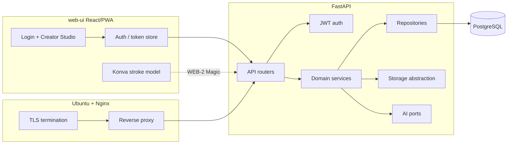

# FashionRise — Architecture overview

## Purpose

FashionRise is a **premium** fashion creation platform: realistic clothing design, sketching, materials/palettes, gallery/social, AI sketch jobs (when configured), and designer handoff.

## Platform targets

| Priority | Platform | Notes |
|----------|----------|--------|
| **Active** | **Web PWA** (`web-ui/`) | Tablet-first; installable standalone; PC/desktop supported |
| **Active** | **API** (FastAPI) | Shared backend for all clients |
| **Later** | Tauri / native shell | Optional packaging of the same web app |
| **Legacy** | Unity (Windows/Android) | Retained under `FashionRise/` as historical reference only |

## System context

## Architectural principles

### Active web client (`web-ui/`)

- **Simple product flow:** Login → Creator Studio (no dashboard gate).
- **Structured strokes** (not only flattened bitmaps) for future tools.
- **Design tokens** and CSS modules — FashionRise visual system, not third-party UI kits.
- **PWA standalone** install for app-like chrome.
- **Reuse existing FastAPI contracts** — do not invent a parallel backend.

### Backend

- **Thin routers**, **thick services**; **repositories** own SQLAlchemy access.
- **OpenAPI** is the contract; schemas match persisted domain concepts.
- **JWT**: short-lived access + refresh (server-stored, revocable).
- **Storage**: abstraction over local disk now; S3-compatible driver later.
- **AI**: stable job API and internal provider interface — **no** vendor SDKs embedded in route handlers.

### Legacy Unity client

- Unity remains in-tree for reference and historical behavior.
- **Do not** extend Unity UI as the product frontend.
- See LEGACY docs: `02-unity-client.md`, `unity-*.md`.

### Cross-cutting

- **Idempotency** for expensive operations (uploads, AI jobs) where duplicates hurt.
- **Structured logging**, request correlation, health/readiness for ops.
- **Moderation- and admin-ready** fields on gallery/designs/users (see [Database](./04-database.md)).
